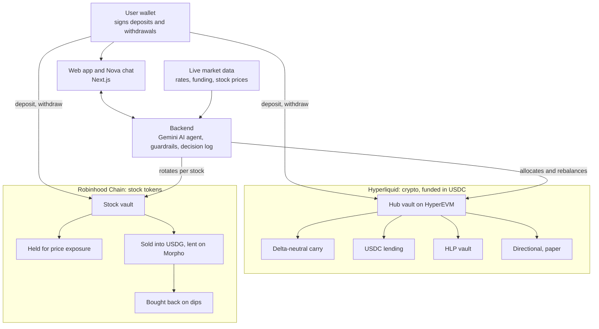

# NovaSIP

**An AI yield optimizer for savings goals.** Set a goal, and Nova spreads your money across crypto yield and tokenized stocks, rebalances as markets move, and explains every move in plain words, inside hard risk limits.

*Nova = new. SIP = systematic investment plan, also called dollar-cost averaging: investing steadily toward a goal.*

- Live app: https://nova-sip.vercel.app
- Backend API: https://novasip-production.up.railway.app (try `/api/performance` for live Hyperliquid and Morpho rates)
- Network: Hyperliquid testnet (HyperEVM) and Robinhood Chain testnet

## The idea

Crypto yield and stocks have lived in separate worlds. Two things changed:

- **Hyperliquid** offers deep on-chain yield tools: hedged carry trades, lending and vaults.
- **Robinhood Chain** brings stocks on-chain as tokens (TSLA, AMZN, AMD, NFLX, PLTR).

Crypto and stocks move independently. NovaSIP puts both in one portfolio managed by an AI, so when one side is down the other can keep earning. The user never picks a strategy: they set a goal, a risk level and an amount.

## How it works



## World 1: Crypto, on Hyperliquid

Users deposit **USDC** into the hub vault on HyperEVM. Nova allocates it across:

| Strategy | What it does |
|---|---|
| **Delta-neutral carry** | Long spot, short perp on ETH to earn funding while staying market-neutral. Opens only when funding beats lending by about 2 points. |
| **USDC lending** | Supplies USDC on Hyperliquid's lending market for steady interest. |
| **HLP vault** | Deposits into Hyperliquid's liquidity vault (4-day lockup per deposit). |
| **Directional** | Small, capped trades on market direction (paper positions in this build). |

## World 2: Tokens, on Robinhood Chain

Users deposit **stock tokens** into the Robinhood Chain vault. Nova decides **per stock**, from where its price sits in the 52-week range:

| Position in 52-week range | Decision |
|---|---|
| 80 or above | Sell 100% into USDG (stablecoin) and lend it on Morpho |
| 65 to 80 | Sell about half |
| 30 to 65 | Hold the stock |
| Below 30 | Hold; buy back if currently in USDG |

Nova **buys back only if it gets at least as many tokens as it sold** (a no-loss rule), and the gain is credited as yield the user can claim. Stock stays in the user's ownership throughout; the vault tracks every rotation on-chain.

## How the AI decides

Nova is a **Gemini** agent running in a TypeScript backend. It is not fine-tuned: it combines the model's general market knowledge with explicit strategy rules and live data.

- **Strategy rules:** a written playbook for the six strategies (carry, lending, HLP, directional, held stocks, stocks in USDG on Morpho) and when each makes sense.
- **Current data:** live funding rates, lending and HLP rates, Morpho USDG vault yields, live stock prices, wallet and vault balances.
- **Historical context:** each stock's 52-week range, recent funding history, and the agent's own past decisions.
- **Tools:** read the portfolio and market, propose an allocation, rotate stocks, open or close positions.
- **Guardrails (enforced in code, not by the model):** per-strategy caps by risk level, chain-specific funds, and at most a 20% change per cycle. A rejected plan is returned to the AI with the limits so it can correct itself.
- **Explainability:** every decision is stored with its reasoning and the numbers it used, and the user can ask "why did you do that?".

### Risk levels and maximum share of the portfolio

| Strategy | Conservative | Balanced | Aggressive |
|---|---|---|---|
| Delta-neutral carry | 40% | 40% | 40% |
| USDC lending | 60% | 40% | 30% |
| HLP vault | 5% | 15% | 25% |
| Directional | 0% | 10% | 25% |
| Stock tokens held | 40% | 70% | 100% |
| Stocks in USDG on Morpho | 100% | 100% | 100% |

## Revenue model

1. **Hyperliquid builder codes (live, verified).** Every perp order the agent routes carries a 0.1% builder fee. Verified on testnet: a $250 order paid $0.25.
2. **Early-exit fee (live in the contracts).** Leaving before the goal date charges a configurable fee, paid to the treasury.
3. **Performance fee (planned).** A small fee on overall profit across both chains, including the stock-token strategy, charged only when users gain. Illustration: at $10M under management and an 8% return, a 10% performance fee is $80K a year.

We earn when our users earn, and revenue grows with assets under management.

## Roadmap

- Automatic monthly deposits, which the user can pause or stop at any time (planned)
- Mainnet launch with real Morpho vaults and real stock tokens
- Per-user isolated accounting for stock rotation
- Independent security audit
- More stocks, more strategies, and goal templates

## Honest scope of this build

- Everything runs on **testnet**.
- **Morpho** and the **stock swap** on Robinhood Chain testnet are contracts we deployed: the lending market uses live Morpho rates, and swaps execute at an operator-set price with a 0.1% fee. This price control is also what lets us trigger a buy-back in a demo.
- Hyperliquid actions run from an **operator wallet** at demo size (carry 0.1 ETH, lending and HLP up to $5); user funds stay in the vaults.
- Stock rotation is tracked per token in the vault and per user in the backend ledger, so withdrawals of a token are pooled across users until per-user isolation ships.
- Directional trades are paper positions.
- The vault contract keeps its on-chain name `NovaSIPVault`.

## Deployments

| Chain | Contract | Address |
|---|---|---|
| HyperEVM testnet (998) | NovaSIPVault (hub) | `0x40B0BcCFfDa3FFB423ce88ca304d6cfA9A6AAb2e` |
| HyperEVM testnet (998) | USDC | `0x2B3370eE501B4a559b57D449569354196457D8Ab` |
| Robinhood Chain testnet (46630) | RHChainVault | `0x40B0BcCFfDa3FFB423ce88ca304d6cfA9A6AAb2e` |
| Robinhood Chain testnet (46630) | MockUSDG | `0x9C160b4Bb98d3d307ceaB34c48065c0205DA0977` |
| Robinhood Chain testnet (46630) | MockMorpho | `0x4190Efba7348eE7F203e374E158b0c94c0da1092` |
| Robinhood Chain testnet (46630) | MockExchange | `0xA75818772043e6Dd9164A166EfeFE6B386Cd028A` |

The two vaults share an address because they were deployed from the same account on two different chains.

## Repository

- `contracts/`: Solidity and Foundry vaults, mock Morpho and exchange
- `backend/`: TypeScript API, AI agent, guardrails, Hyperliquid integration
- `frontend/`: Next.js app and landing page

## Run locally

```bash
# backend (copy your env values first)
cd backend && npm install && npx tsx src/api/server.ts

# frontend
cd frontend && npm install && npm run dev
```

Backend env: `PRIVATE_KEY`, `WALLET_A`, `WALLET_B`, `HL_TESTNET`, `BUILDER_ADDRESS`, `RPC_URL`, `RH_RPC_URL`, `VAULT`, `RH_VAULT`, `RH_USDG`, `RH_MORPHO`, `RH_EXCHANGE`, `GEMINI_API_KEYS`, `GEMINI_MODEL`, `KEEPER_INTERVAL_MIN`, `DATA_DIR`.
Frontend env: `NEXT_PUBLIC_API_URL`.